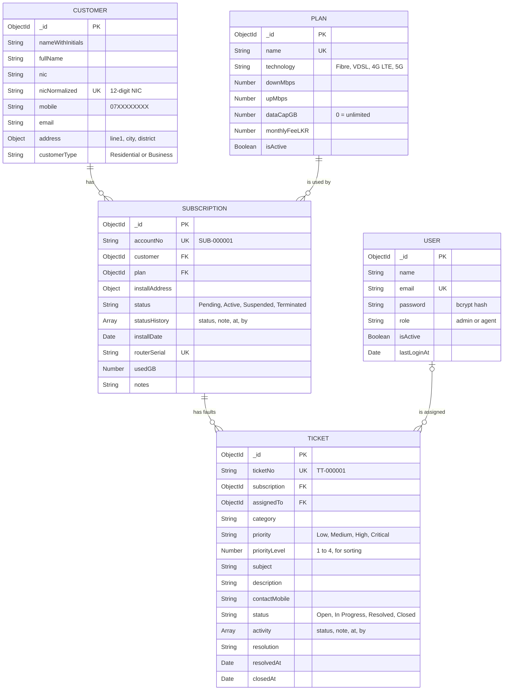

# Uplink

Uplink is an internal broadband management system for the staff of an internet service provider. Staff register customers, manage broadband plans, take new connection orders and track faults until they are fixed. It uses Sri Lankan data: NIC numbers, mobile numbers, districts and fees in LKR.

Built with MongoDB, Express, React and Node.js.


## Features

- **Sign in:** every page needs a staff login. There are two roles, admin and agent.
- **Customer Accounts:** add, view, edit and delete customers. Old and new NIC formats are checked, and date of birth and gender are read from the NIC.
- **Product Catalogue:** add, edit and delete broadband plans, or take them off sale.
- **Subscriptions:** order a connection and move it through Pending, Active, Suspended and Terminated.
- **Trouble Tickets:** log faults and move them through Open, In Progress, Resolved and Closed.
- **Access Control:** admins add, edit, disable and delete staff accounts.
- **Dashboard:** key figures and simple bar charts.
- **Lists:** search, filter and sort on each list page.
- **Safe delete:** records that are still in use cannot be deleted, and every delete asks for confirmation.

## Getting started

You need Node.js 20 or newer and MongoDB running locally on port 27017.

```bash
git clone https://github.com/Isuri-Aroma/Uplink.git
cd Uplink
```

Set up the server:

```bash
cd server
npm install
cp .env.example .env
```

Open `server/.env` and set `JWT_SECRET` to any long random string. Then load the demo data and start the API:

```bash
npm run seed
npm run dev
```

In a second terminal, start the client:

```bash
cd client
npm install
npm run dev
```

Open http://localhost:5173.

## Demo accounts

| Role | Email | Password |
|---|---|---|
| Admin | `admin@uplink.lk` | `Admin@1234` |
| Agent | `supun@uplink.lk` | `Agent@1234` |

## Database design



A `counters` collection holds the last account and ticket number. Each collection also stores `createdAt` and `updatedAt`.

## Screenshots

| | |
|---|---|
|  Sign in |  Customer accounts |
|  Product catalogue |  Edit plan |
|  Subscriptions |  Subscription details |
|  Trouble tickets |  Access control |


## Credits

Sign-in photo by [Kirill Sh](https://unsplash.com/photos/fiber-optic-cables-in-network-switch-eVWWr6nmDf8) on Unsplash.

## Author

Isuri Aroma
