# Uplink

Uplink is an internal broadband management system for the back office of an internet service provider. Staff use it to register subscribers, manage the product catalogue of broadband plans, take new connection orders through to activation, and track faults until they are fixed.

It models the CRM, product catalogue, order management and trouble ticketing parts of a telecom business support system (BSS), using Sri Lankan data: NIC numbers, mobile numbers, districts and fees in LKR.

Built with the MERN stack (MongoDB, Express, React, Node.js) for the Web Application Development mini project.

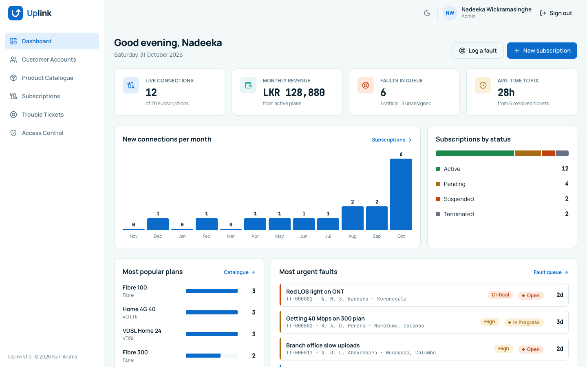

## Contents

- [Features](#features)
- [Tech stack](#tech-stack)
- [Getting started](#getting-started)
- [Demo accounts](#demo-accounts)
- [Database design](#database-design)
- [API reference](#api-reference)
- [Validation and error handling](#validation-and-error-handling)
- [Roles and permissions](#roles-and-permissions)
- [Project structure](#project-structure)
- [Screenshots](#screenshots)
- [Credits](#credits)

## Features

**Sign in and access control**
- Internal app: every page and API route requires sign-in. Sessions use a JWT that lasts 8 hours.
- Two roles, admin and agent, enforced on the server and in the interface.
- New staff can request access from the sign-in page. An admin approves (choosing the role) or rejects with a reason. Pending and rejected applicants see a clear message when they try to sign in.
- Admins add, edit, disable and remove staff and reset passwords. An admin cannot demote, disable or delete their own account, and the last active admin cannot be removed.

**Dashboard**
- Live connections, monthly revenue from active plans, faults in the queue and average time to fix.
- New connections per month (last 12 months), subscriptions by status, most popular plans and the most urgent open faults.

**Customer Accounts (CRM)**
- Register, view, edit and delete subscribers.
- Sri Lankan NIC validation for both formats: old (`901234567V`) and new (`199012304567`). Date of birth and gender are read from the NIC, customers must be 18 or older, and the old and new NIC of the same person count as a duplicate.
- Directory grouped by surname, with search by name, NIC or mobile and filters by district and customer type.
- Customer details page with profile, address and all of the customer's subscriptions.

**Product Catalogue**
- Broadband plans (Fibre, VDSL, 4G LTE, 5G) with download and upload speed, data cap or unlimited, and monthly fee.
- Plans can be taken off sale without being deleted. A plan in use by any subscription cannot be deleted.

**Subscriptions**
- Order a connection for a customer on an active plan, at the customer's address or another site. Account numbers are generated automatically (`SUB-000001`).
- Status lifecycle with allowed changes only: Pending, Active, Suspended, Terminated. Suspending or terminating needs a reason. Every change is recorded with who made it and when.
- Data usage against the plan cap, router serial number and plan changes.
- Status tabs with counts, search by account, router, customer name, NIC or mobile, filters by plan and district.
- Service order PDF: a connection form for the customer to sign.

**Trouble Tickets**
- Log faults against a live subscription with category, priority and a call-back number. Ticket numbers are generated automatically (`TT-000001`).
- Workflow: Open, In Progress, Resolved, Closed, with reopen. Resolving needs a resolution note. Only closed tickets can be deleted.
- Fault queue sorted by urgency, showing how long each ticket has been open and who it is assigned to.
- Field job card PDF for technicians, with space for work done, parts used and signatures.

**Interface**
- Light and dark themes (light by default), responsive layouts for phones and desktops.
- Search, filter and sort on every list.

## Tech stack

| Layer | Technology |
|---|---|
| Front end | React 18, Vite 5, React Router 6, Tailwind CSS 3, Axios, lucide-react icons, react-hot-toast, jsPDF |
| Back end | Node.js, Express 4, express-validator, JSON Web Tokens (jsonwebtoken), bcryptjs |
| Database | MongoDB with Mongoose 8 |
| Charts | Hand-built SVG components (no chart library) |

## Getting started

### Prerequisites

- Node.js 20 or newer
- MongoDB 6 or newer, running locally on port 27017 (or a MongoDB Atlas connection string)
- Git

### 1. Clone the repository

```bash
git clone https://github.com/Isuri-Aroma/Uplink.git
cd Uplink
```

### 2. Set up the server

```bash
cd server
npm install
cp .env.example .env
```

Edit `server/.env`:

| Variable | Example | Purpose |
|---|---|---|
| `PORT` | `5050` | API port. 5050 is used because macOS uses 5000 for AirPlay. |
| `MONGODB_URI` | `mongodb://127.0.0.1:27017/uplink` | MongoDB connection string |
| `CLIENT_URL` | `http://localhost:5173` | Front-end address allowed by CORS |
| `NODE_ENV` | `development` | Shows error details in development |
| `JWT_SECRET` | a long random string | Signs sign-in tokens. Generate one with `node -e "console.log(require('crypto').randomBytes(32).toString('hex'))"` |
| `JWT_EXPIRES_IN` | `8h` | How long a sign-in lasts |

Load the demo data, then start the API:

```bash
npm run seed    # clears the uplink database and loads demo data
npm run dev     # starts the API on http://localhost:5050
```

Check it is running: http://localhost:5050/api/health

### 3. Set up the client

In a second terminal:

```bash
cd client
npm install
npm run dev     # starts the app on http://localhost:5173
```

Open http://localhost:5173 and sign in with a demo account. During development Vite forwards `/api` requests to the server, so no extra configuration is needed.

### Scripts

| Folder | Command | What it does |
|---|---|---|
| server | `npm run dev` | Start the API with auto-restart (nodemon) |
| server | `npm start` | Start the API |
| server | `npm run seed` | Reset the database with demo data |
| client | `npm run dev` | Start the React app |
| client | `npm run build` | Build the app for production into `client/dist` |

## Demo accounts

Created by `npm run seed`:

| Role | Email | Password |
|---|---|---|
| Admin | `admin@uplink.lk` | `Admin@1234` |
| Agent | `supun@uplink.lk` | `Agent@1234` |
| Agent | `tharushi@uplink.lk` | `Agent@1234` |
| Agent (disabled) | `kasun@uplink.lk` | `Agent@1234` |

The seed also adds 9 plans, 15 customers, 20 subscriptions in every status, 12 trouble tickets and 3 access requests.

## Database design

Seven MongoDB collections. References between documents use ObjectIds; status histories and addresses are embedded because they are always read with their parent.

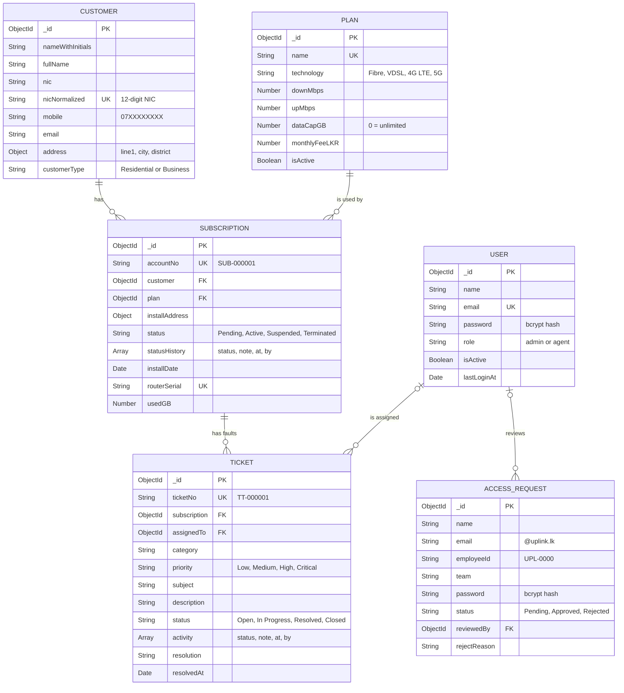

A seventh collection, `counters`, holds the last account and ticket number so new numbers are generated atomically.

**Integrity rules**
- Unique keys: user email, plan name, customer NIC (normalised, so both NIC formats are checked), account number, ticket number and router serial.
- A plan, customer or subscription that other records depend on cannot be deleted. The API returns `409 Conflict` with the reason, for example `2 subscription(s) use "Fibre 300". Mark the plan inactive instead.`
- Active or suspended subscriptions must be terminated before they can be deleted, and only closed tickets can be deleted.
- Deleting a staff member unassigns their tickets instead of deleting them.

## API reference

All routes start with `/api`. Every route except sign-in, access requests (create) and the health check needs the header `Authorization: Bearer <token>`.

| Method | Route | Access | Description |
|---|---|---|---|
| GET | `/health` | Public | API and database status |
| POST | `/auth/login` | Public | Sign in, returns a token |
| GET | `/auth/me` | Staff | Current user |
| GET | `/auth/staff` | Staff | Active staff for assigning tickets |
| POST | `/access-requests` | Public | Request an account |
| GET | `/access-requests` | Admin | List requests with counts |
| PATCH | `/access-requests/:id/approve` | Admin | Approve and create the account |
| PATCH | `/access-requests/:id/reject` | Admin | Reject with a reason |
| DELETE | `/access-requests/:id` | Admin | Delete a reviewed request |
| GET | `/dashboard` | Staff | All dashboard figures |
| GET | `/customers` | Staff | List: `search`, `district`, `type`, `sort` |
| GET | `/customers/:id` | Staff | Customer with their subscriptions |
| POST | `/customers` | Staff | Register a customer |
| PUT | `/customers/:id` | Staff | Edit a customer |
| DELETE | `/customers/:id` | Admin | Delete a customer with no subscriptions |
| GET | `/plans` | Staff | List: `search`, `technology`, `status`, `sort` |
| GET | `/plans/:id` | Staff | One plan |
| POST | `/plans` | Admin | Add a plan |
| PUT | `/plans/:id` | Admin | Edit a plan |
| DELETE | `/plans/:id` | Admin | Delete a plan not in use |
| GET | `/subscriptions` | Staff | List: `search`, `status`, `plan`, `district`, `sort` |
| GET | `/subscriptions/:id` | Staff | One subscription with history |
| POST | `/subscriptions` | Staff | Order a new connection |
| PUT | `/subscriptions/:id` | Staff | Change plan, address, router, usage, notes |
| PATCH | `/subscriptions/:id/status` | Staff | Change status with a note |
| DELETE | `/subscriptions/:id` | Admin | Delete a pending or terminated subscription |
| GET | `/tickets` | Staff | List: `search`, `status` (`queue` = open work), `priority`, `category`, `assignedTo` (`me`, `none`), `sort` |
| GET | `/tickets/:id` | Staff | One ticket with activity |
| POST | `/tickets` | Staff | Log a fault |
| PUT | `/tickets/:id` | Staff | Edit details or assignee |
| PATCH | `/tickets/:id/status` | Staff | Change status (resolving needs a note) |
| DELETE | `/tickets/:id` | Staff | Delete a closed ticket |
| GET | `/users` | Admin | List staff: `search`, `role`, `status`, `sort` |
| POST | `/users` | Admin | Add staff |
| PUT | `/users/:id` | Admin | Edit staff or reset password |
| DELETE | `/users/:id` | Admin | Remove staff |

## Validation and error handling

- **Client side:** every form checks its fields before sending and shows the message under the field.
- **Server side:** express-validator checks each request, and the Mongoose schemas apply the same rules again.
- **One error format:** the error middleware returns `{ message, details }` for every error. Invalid fields give `400` with one message per field, a bad id gives `400`, a missing record `404`, a duplicate `409`, no sign-in `401` and a missing permission `403`.
- Unknown routes return `404` in the same format, and unexpected errors are logged on the server without crashing it.

## Roles and permissions

| Action | Admin | Agent |
|---|---|---|
| View everything | Yes | Yes |
| Register and edit customers | Yes | Yes |
| Create and edit subscriptions, change status | Yes | Yes |
| Log, edit and work tickets | Yes | Yes |
| Create, edit and delete plans | Yes | View only |
| Delete customers and subscriptions | Yes | No |
| Manage staff and access requests | Yes | No |

## Project structure

```
Uplink/
├── client/                     React app (Vite)
│   └── src/
│       ├── api/                One file per resource (axios calls)
│       ├── components/         Layout, shared UI, charts, sign-in layout
│       ├── context/            Auth and theme state
│       ├── features/           Pages and forms per module
│       │   ├── customers/
│       │   ├── plans/
│       │   ├── subscriptions/
│       │   ├── tickets/
│       │   └── staff/
│       ├── hooks/              useDebounce, useWidth
│       ├── pages/              Sign in, request access, dashboard, 404
│       └── utils/              Formatting, NIC, PDF, status colours
├── server/                     Express API
│   ├── config/                 Database connection
│   ├── controllers/            Request handlers
│   ├── middleware/             Auth, validation, errors
│   ├── models/                 Mongoose schemas
│   ├── routes/                 Route definitions
│   ├── scripts/seed.js         Demo data
│   ├── utils/                  NIC, districts, helpers
│   └── validators/             express-validator rules
└── docs/screenshots/           Images used in this README
```

## Screenshots

| | |
|---|---|
| 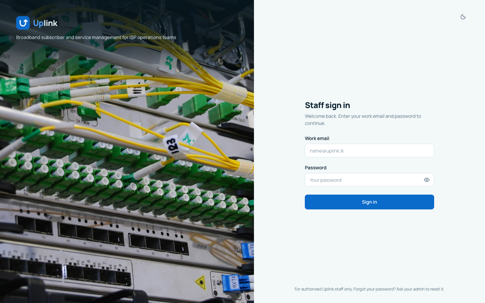 Sign in | 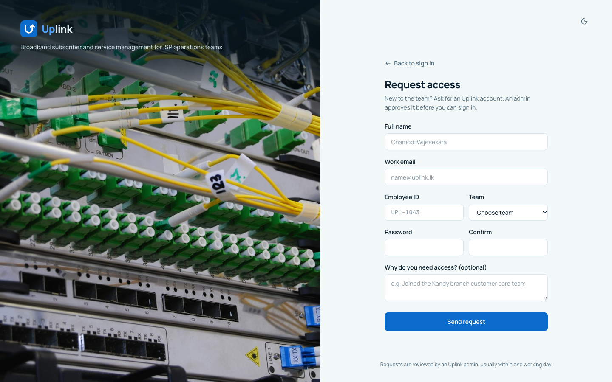 Request access |
|  Dashboard | 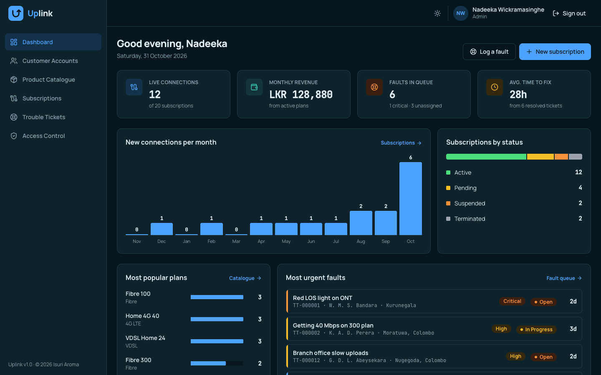 Dashboard, dark theme |
| 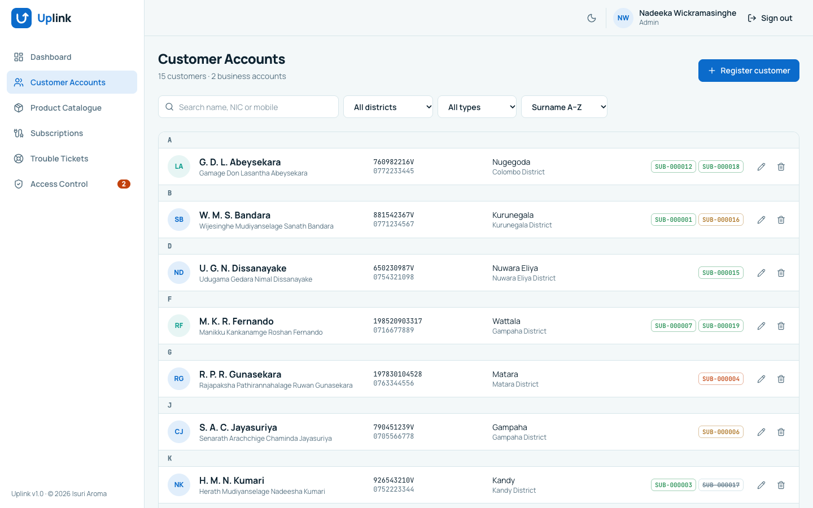 Customer accounts | 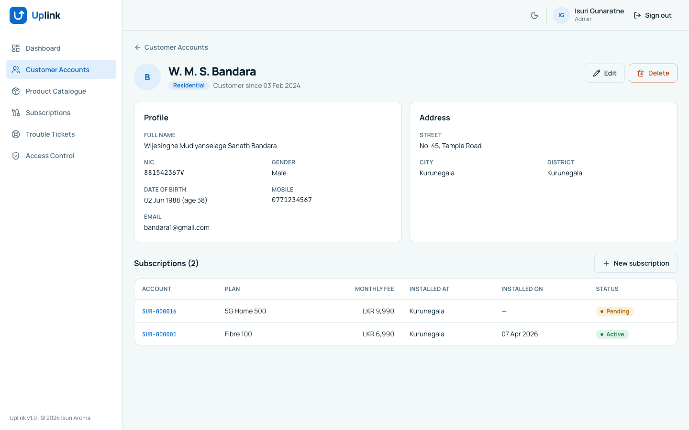 Customer details |
| 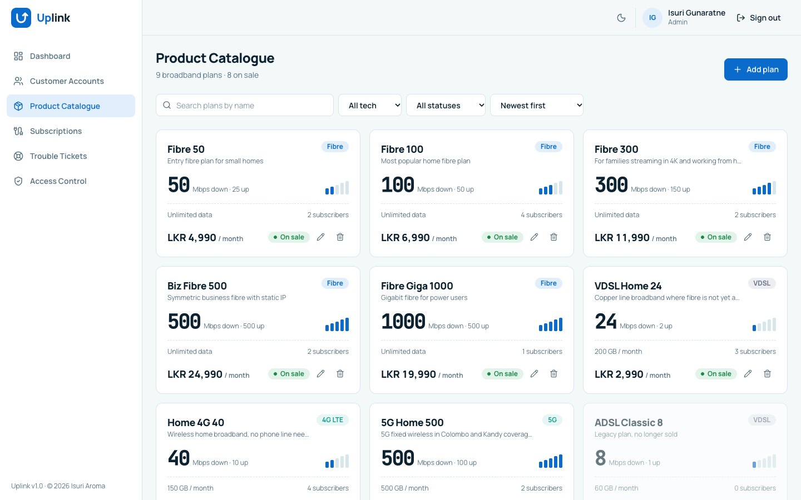 Product catalogue | 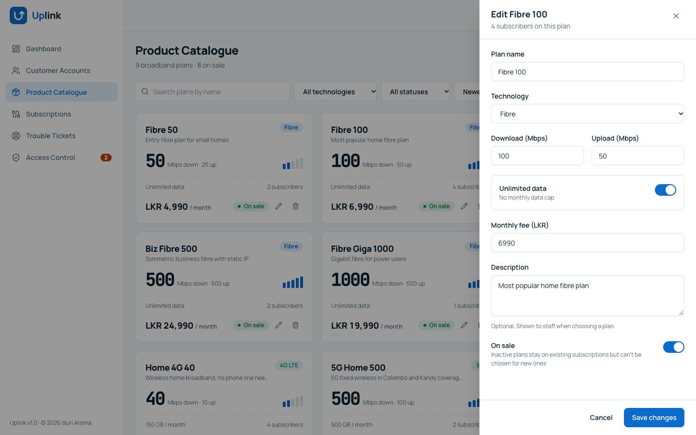 Edit plan |
| 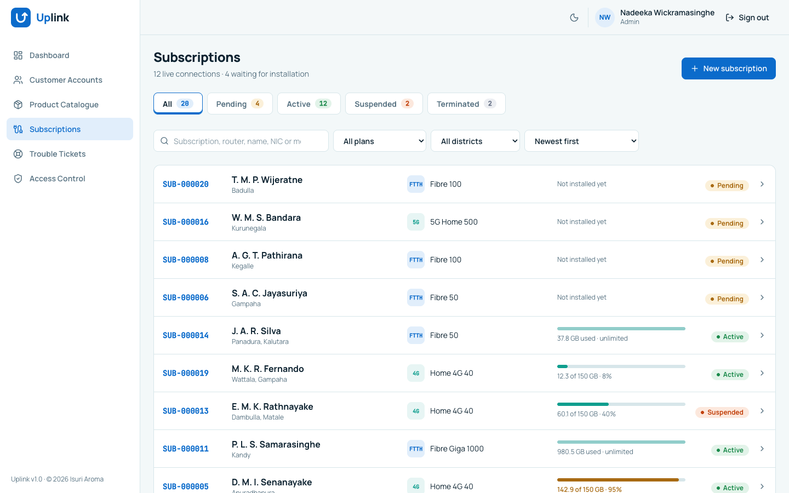 Subscriptions | 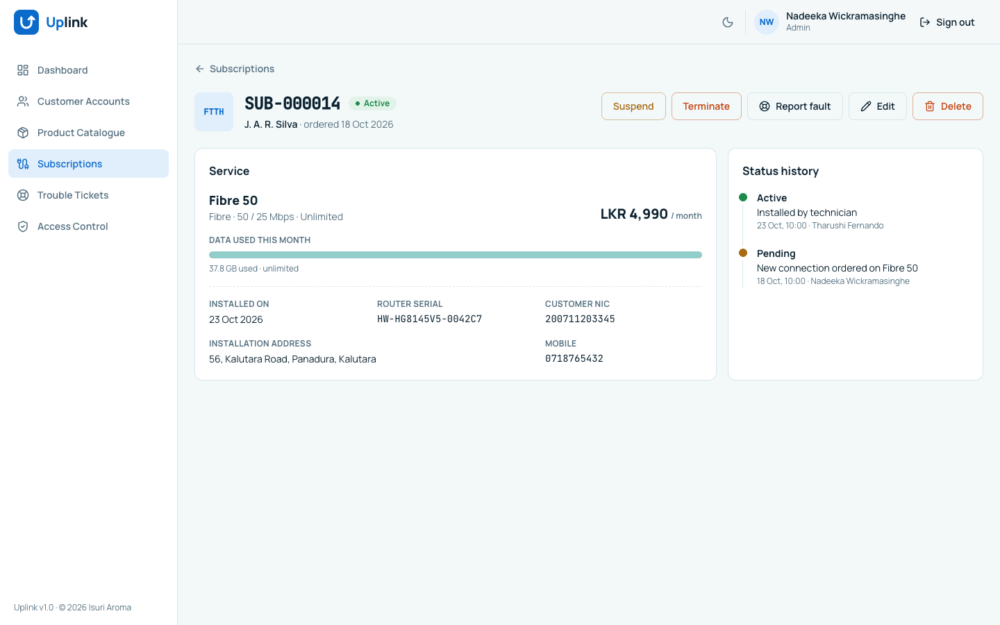 Subscription details |
| 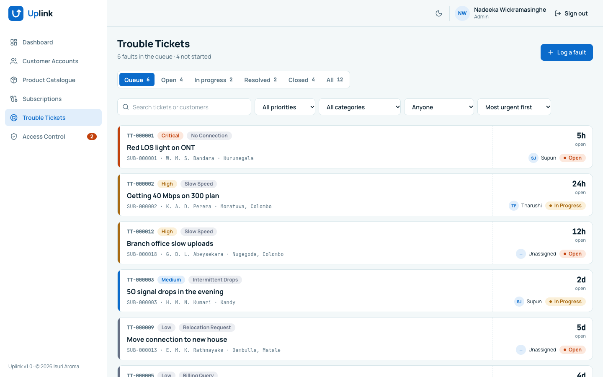 Trouble tickets | 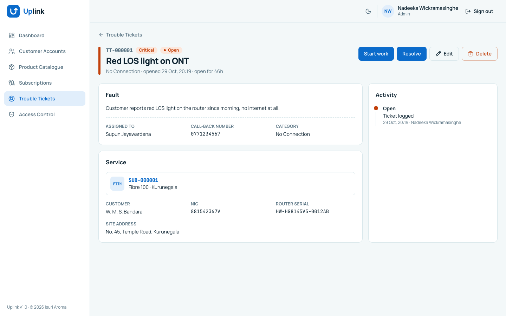 Ticket details |
| 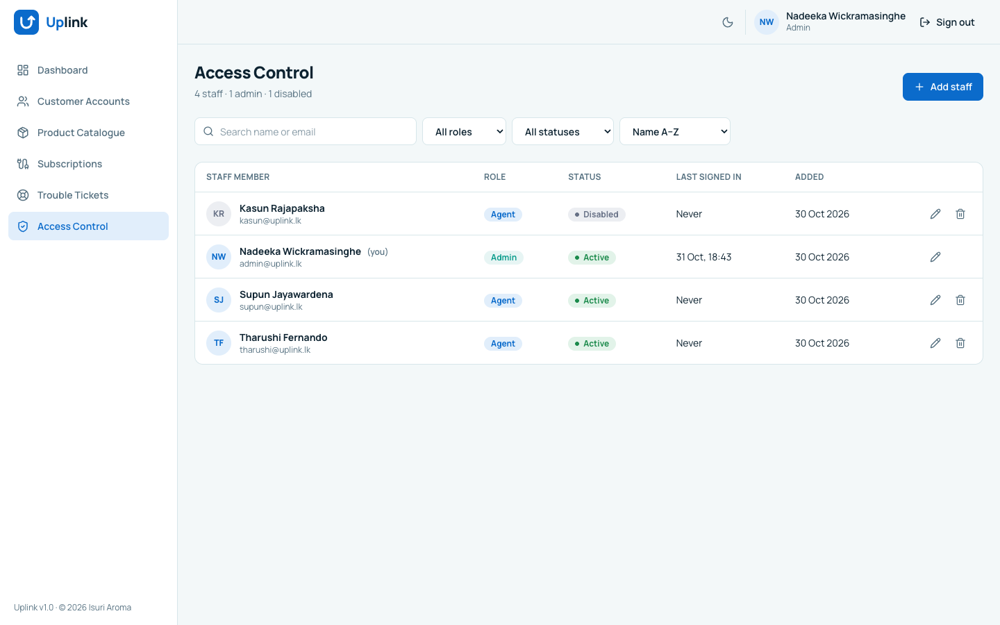 Access control | 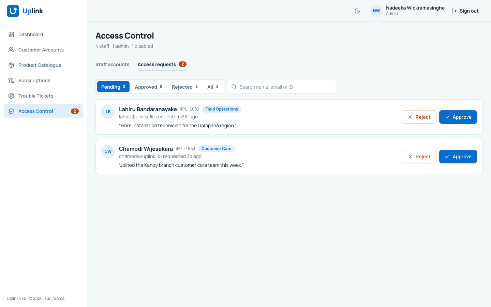 Access requests |

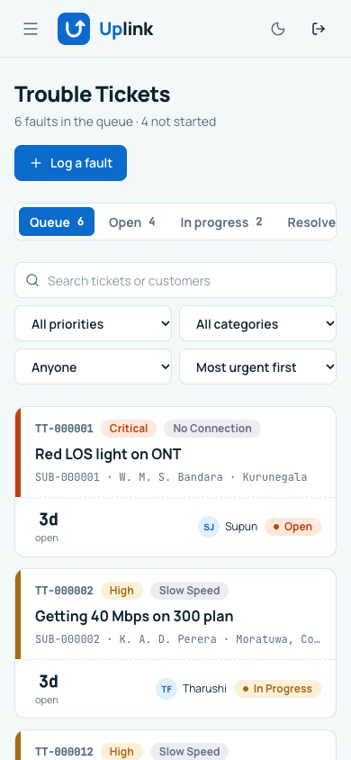

## Credits

- Sign-in photo: fibre optic cables in a network switch by [Kirill Sh](https://unsplash.com/photos/fiber-optic-cables-in-network-switch-eVWWr6nmDf8) on Unsplash.
- Fonts: Manrope and JetBrains Mono from Google Fonts.
- Icons: lucide-react.

## Author

Isuri Aroma
EC4307 Web Application Development, mini project, 2026.
